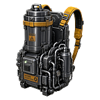

# WePlay: Thumper — Crowd Control Equipment (`WePlayThumper`)

A piston backpack that slams the ground when biters close in. A shockwave of heaving dirt and dust rolls outward, shoves them back and leaves the ground cracked, slowing them down. It buys you time, not immunity.

- **Factorio:** 2.1
- **Dependencies:** base ≥ 2.1.0 (Space Age not required)
- **Current version:** 0.2.6
- **Mod portal:** https://mods.factorio.com/mod/WePlayThumper

## In game

Thumper fires on its own when any enemy unit (biter, spitter or pentapod) is within 10 tiles, at most once every 1.2 seconds, as long as the wearer is on the ground. The piston clangs, and 0.1 s later the boom punches a crater at the wearer's feet and the shockwave rolls out 10 tiles in 10 ticks.

| When the front reaches... | What happens |
|---|---|
| Biters and spitters | 8 physical damage, a shove of up to 8 tiles straight away from the thump (stopping at walls, buildings, trees, rocks, cliffs and water), a stagger of up to 1 s at 15% speed, then an order to attack the wearer |
| Worms, nests and long-legged pentapods | 8 physical damage only |

**Shove fatigue:** each recent thump an enemy has taken makes its next shove and stagger 60% of the last (8 → 4.8 → 2.9 → 1.7 tiles…). It resets after 10 s without a thump.

**Cracked ground:** each thump's crater comes with a cracked-lakebed disc (10.5 tiles) revealed ring by ring as the front passes. Each player's newest disc slows enemy units on it: 25% slower at the default strength, minus 10% of that per fatigue level (25% → 23% → 20% → 18%…), so veterans push through faster but never reach full speed. Older discs are scenery.

**Scars:** craters and cracks last 3 minutes by default, then fade out over 30 s. Thumping within 2 tiles of a crater refreshes it instead of adding another; new cracks only open more than 6 tiles from existing ones (refreshing the nearby patch and making it your active one otherwise). At most 20 crack discs and 60 craters are kept, oldest dropped first.

**Hard mode** (off by default): players on cracked ground are slowed too, unless their armor has movement-bonus equipment (an exoskeleton or a modded one). Players in vehicles or in the air aren't affected.

**On the ground only:** no thumping while jetpacking (Jetpack mod: asks its `is_jetpacking` remote interface and checks for its `-jetpack` flying character) or while mech armor is hovering (any armor that provides flight counts as airborne while over a tile or entity a character can't walk on, since the API has no flying flag).

**One per grid:** a second Thumper placed in the same grid is handed back. If you're in a vehicle with one and wear one too, only one thumps: the higher quality one, or the vehicle's if they match.

### Look and sound

- **Front:** about 370 rounded dirt bricks that pop up for 4 ticks with long shadows, from 0.55× size near the wearer to 1.3× at the edge, plus about 80 dust puffs (1× to 2.8×) swelling just behind them.
- **Crater:** a carved-out depression with jagged cracks and loose clods (3 variants).
- **Cracked lakebed:** plates about 1.35 tiles across near the crater growing to about 4 at the rim, where the mud fill fades out and only jagged cracks are left. Cracks are deep and dark near the centre and shallow and light at the rim. Each disc gets a random rotation.
- **Sound:** a metal piston clang leading into an explosion, then one of three earthquake rumbles.

## Player settings

| Setting | Default | What it does |
|---|---|---|
| Thumper sounds | On | Hear the clang, boom and rumble. |
| Thumper visual effects | On | See the shockwave, dust, craters and cracks. Thumper still works with this off. |

## Map settings

| Setting | Default | Range | What it does |
|---|---|---|---|
| Knockback (%) | 100 | 0 – 300 | Scales shove distance and stagger. 0 turns knockback off. |
| Damage (%) | 100 | 0 – 1000 | Scales the 8 physical damage per thump. |
| Scar duration (seconds) | 180 | 5 – 1800 | How long craters and cracks stay before a 30 s fade. |
| Cracked ground slowdown strength (%) | 50 | 0 – 100 | 100% = 50% slower, 50% = 25% slower. 0 turns it off. |
| Hard mode: cracked ground slows players too | Off | On / Off | Players without an exoskeleton are slowed on cracked ground too. |

**Sound sensitivity:** Thumper makes a loud clang and boom every 1.2 seconds while enemies are near. Turn off Thumper sounds in your player settings to mute it; Thumper still works without sound.

## Getting it

Research **Thumper** after Modular armor, Engine, Advanced circuit and Military 2 (200 × automation, logistic and military science, 30 s each).

| Recipe | |
|---|---|
| Ingredients | 4 × Engine unit, 5 × Advanced circuit, 10 × Steel plate |
| Crafting time | 10 s |
| Equipment size | 2 × 2 |
| Power | 1 MJ buffer, charges at up to 300 kW; 120 kJ per thump |

## How it works

- **Equipment:** a `battery-equipment` that only charges (`output_flow_limit = 0W`). The script spends its energy on each thump.
- **Wearers:** every 6 ticks, each connected player whose Thumper is ready and charged is checked for enemy units within 10 tiles. The best Thumper is used, centred on the vehicle if driving, otherwise the character.
- **Wave:** enemies within reach are listed when the thump fires and each is hit on the tick the front reaches it. Shoves are spread over 6 ticks of small teleports (fast, then easing off), each step checked against water tiles and anything on the `player` collision layer that isn't a unit or vehicle. Stagger is one of ten `wp-thumper-stagger-N` stickers; after the shove the unit gets an `attack` command on the wearer.
- **Front:** a fixed pattern of bricks and dust (built once from a fixed seed, so it's identical in multiplayer), drawn with `rendering.draw_animation` with `time_to_live`, scaled per distance, `animation_offset` set so each starts on frame 0. Bricks are baked in 16 directions so the top-left light stays put.
- **Scars:** craters and lakebed sectors are `rendering.draw_sprite` objects on the first ground layer that works (`ground-patch-higher2`, `ground-patch-higher`, `ground-patch`, `decals`). The lakebed disc is cut into 157 ring sectors packed into one atlas (`lakebed_sectors.lua`); each disc is rotated by moving each sector's offset and setting its `orientation`. Fading is done by script every 15 ticks.
- **Rough ground:** every 10 ticks, enemy units on each player's newest disc get one of the `wp-thumper-rough-N` stickers (1% steps, 20-tick life, refreshed while they stay on it).

Balance and tuning numbers live in `balance.lua`.

### Not in this pass

- Tier weights (big enemies resisting the shove) are in `balance.lua` but switched off.
- Concrete and other paved tiles get dirt bricks and cracks like any other ground.
- Spidertrons driven by remote, and grids filled by robots (only player-placed duplicates are handed back).
- Research or quality bonuses.

## Tools (not in the zip)

Need Python with numpy, pillow and scipy (`pip install numpy pillow scipy`), plus ffmpeg on your PATH.

- `python tools/thumper_crater.py <out>`: builds the three crater variants.
- `python tools/thumper_wave3.py <out>`: builds the bricks, dust and lakebed disc and renders preview videos (uses `thumper_wave2.py` for the bricks).
- `python tools/thumper_pack.py <out> .`: splits the bricks per direction, cuts the lakebed into ring sectors and packs them into `graphics/entity` and `lakebed_sectors.lua`.
- `python tools/build_icons.py <master.png> <out>`: builds the icons and thumbnail, with the brighter, outlined treatment for the small icon.

## Made with AI

AI was used heavily in the production of this mod. The code, documentation and portal description were written with Claude (Anthropic's AI assistant). The equipment icon, technology icon and thumbnail were generated with Grok. The shockwave, dust, crater and cracked ground are made by Python scripts rather than drawn, and the sounds were cut and layered from licensed stock clips; those scripts were also written with AI. The design is directed, and every version played, tested and tuned in game, by the author.

## Credits

- The equipment icon, technology icon and thumbnail were made with AI image generation (Grok).
- The shockwave, dust, crater and cracked ground were made procedurally for this mod.
- Sounds were built from Envato Elements assets ("Bright Explosion", "Earthquake - One Shot" and "Epic Metal Impact"), cut, layered and faded for the thump and the rumble. The sound files are used under the Envato Elements licence and are not covered by the Unlicense.

## Licence

Code released under the Unlicense (the sound files stay under their Envato Elements licence).
